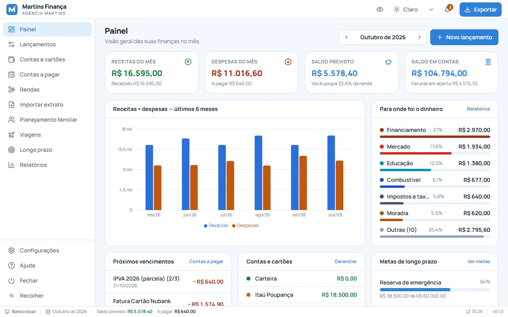

<p align="center">
  
</p>

<h1 align="center">Martins Finança</h1>

<p align="center">
  Controle financeiro pessoal e familiar — <b>gratuito, open source e offline</b>.<br/>
  Windows · macOS · Linux · por <b>Agência Martins</b>
</p>

<p align="center">
  
</p>

---

## Por que existe

Nós, brasileiros, precisamos de um jeito **gratuito** de cuidar do próprio dinheiro: sem assinatura, sem anúncio e sem entregar a senha do banco para ninguém. O Martins Finança guarda tudo num arquivo no seu computador e funciona sem internet.

## Recursos (MVP)

| Área | O que faz |
|---|---|
| **Painel** | Receitas, despesas, saldo previsto, saldo em contas, gráfico de 6 meses, gastos por categoria, vencimentos, metas |
| **Lançamentos** | Receitas e despesas pessoais ou familiares, por categoria/conta/membro; parcelamento; filtros por mês, tipo, situação, categoria, conta, gasto e membro; busca |
| **Contas e cartões** | Conta corrente, poupança, investimentos, carteira; cartão de crédito com limite, fechamento e vencimento — compras caem na fatura certa e parcelas nas faturas seguintes; pagar fatura com um clique |
| **Contas a pagar** | Contas avulsas, contas fixas, financiamento da casa e de veículo, empréstimo, consórcio, assinatura, mensalidade, impostos — gera os lançamentos de cada mês automaticamente, com parcela atual e saldo devedor |
| **Rendas** | CLT, PJ, autônomo, servidor, aposentadoria, aluguel, benefícios — bruto, líquido e dia do pagamento |
| **Importar extrato** | OFX e CSV (com mapeamento de colunas), detecção de duplicados e sugestão de categoria |
| **Planejamento familiar** | Orçamento mensal por categoria (planejado × realizado), sugestão pela média de 3 meses, copiar do mês anterior, membros da família, referência 50/30/20 |
| **Viagens** | Orçamento, itens previstos × reais, custo por viajante e por dia, quanto guardar por mês, gastos lançados durante a viagem |
| **Longo prazo** | Metas com projeção de juros compostos, aporte necessário até a data-alvo, reserva de emergência sugerida (6× gasto médio) |
| **Relatórios** | Mensal completo, evolução por período, por categoria, lista de lançamentos — tela, **PDF** e **CSV** (Excel) |
| **Notificações** | Sino com vencidos, vencendo hoje e próximos; notificação do sistema 1× por dia |
| **Rede local** | Um computador compartilha o banco; os outros da casa se conectam pelo mesmo Wi-Fi com código de acesso |
| **Configurações** | Modal: tema claro/escuro/sistema, tamanho da fonte, notificações, rede local, categorias, backup/restauração, ajuda, sobre |
| **Extras** | Modo privacidade (borra valores), barra de status com modo do banco/saldo/vencidos, atalhos (Ctrl/⌘+Enter, Esc) |

## Arquitetura

```
┌──────────────── App desktop (Tauri 2) ────────────────┐
│  React + TypeScript + Tailwind (src/)                  │
│     │  invoke("db_query" | "db_execute" | "db_batch")   │
│     ▼                                                  │
│  Rust (src-tauri/)                                     │
│     ├─ modo LOCAL / SERVIDOR → SQLite (rusqlite, WAL)  │
│     └─ modo CLIENTE ──HTTP+token──► outro computador   │
│                                     (axum, porta 47820)│
└────────────────────────────────────────────────────────┘
```

- **Valores em centavos (INTEGER)** — nada de erro de arredondamento com `REAL`.
- **Migrações** versionadas por `PRAGMA user_version` em `src-tauri/src/migrations.rs` (nunca edite uma publicada; adicione outra).
- **Rede local:** o SQLite **não** é aberto por pasta compartilhada (SMB/NFS corrompe o arquivo). Um computador é o dono do arquivo e expõe uma API HTTP protegida por código; os demais enviam as consultas para ele. `ATTACH`, `VACUUM` e afins são bloqueados.
- **Lançamentos recorrentes** são gerados de forma idempotente (`ref_key` único) para o mês atual e o seguinte a cada abertura.

```
apps/
  desktop/         app Tauri (React + Rust)
  web/             landing page (React + TypeScript + Tailwind), publicada no GitHub Pages
```

```
apps/desktop/
  src/
    components/    layout (Header, Sidebar, StatusBar), gráficos, modais, UI
    lib/           db.ts (ponte com Rust), repo.ts (regras de negócio), importers.ts,
                   export.ts (PDF/CSV), reports.ts, format.ts, prefs.ts
    pages/         Painel, Lançamentos, Contas, Contas a pagar, Rendas, Importar,
                   Planejamento familiar, Viagens, Longo prazo, Relatórios, Ajuda
    settings/      modal de Configurações
  src-tauri/src/   lib.rs (comandos), db.rs, lan.rs (servidor/cliente), migrations.rs
  tests/           testes das regras de negócio rodando o SQL real (node:sqlite)
```

## Desenvolvimento

Monorepo com **pnpm** (workspaces). Pré-requisitos: **Node 22+**, **pnpm 9+** (`corepack enable`), **Rust estável** e as [dependências do Tauri](https://v2.tauri.app/start/prerequisites/) do seu sistema (no Linux: `libwebkit2gtk-4.1-dev librsvg2-dev`).

```bash
pnpm install
pnpm desktop:dev     # abre o app em modo desenvolvimento
pnpm desktop:build   # gera instaladores para o seu sistema
pnpm web:dev         # site (landing page) em http://localhost:5173
pnpm web:build
pnpm test            # testes de regras de negócio (SQL real)
pnpm typecheck       # todos os pacotes
cd apps/desktop/src-tauri && cargo test
```

## Publicar uma versão (GitHub Actions)

1. Atualize a versão em `apps/desktop/package.json`, `apps/desktop/src-tauri/Cargo.toml` e `apps/desktop/src-tauri/tauri.conf.json`.
2. `git tag v0.1.0 && git push origin v0.1.0`
3. O workflow **Release** compila Windows (.exe/.msi), macOS Apple Silicon e Intel (.dmg) e Linux (.AppImage/.deb/.rpm) e publica a Release com os instaladores — o botão de download do site passa a apontar para eles automaticamente.

Outros workflows: **CI** (tipos, testes, build, `cargo fmt`, `clippy`, `cargo test`) em todo push/PR, e **Site** (publica `apps/web` no GitHub Pages — ative em *Settings → Pages → Source: GitHub Actions*). O Dependabot atualiza dependências mensalmente.

> O repositório (`SilvaneiMartins/martins-financa`) é configurado em `apps/web/src/lib/config.ts` (`REPO`) e em `apps/desktop/src/lib/constants.ts` (`REPO_URL`).

### Assinatura de código (opcional)

Sem assinatura o app funciona, mas na primeira abertura:
- **Windows:** SmartScreen → *Mais informações* → *Executar assim mesmo*.
- **macOS:** clique com o botão direito no app → *Abrir* (ou `xattr -cr "/Applications/Martins Finança.app"`).

Para remover os avisos no macOS, configure os secrets `APPLE_CERTIFICATE`, `APPLE_CERTIFICATE_PASSWORD`, `APPLE_SIGNING_IDENTITY`, `APPLE_ID`, `APPLE_PASSWORD` e `APPLE_TEAM_ID` (conta Apple Developer). No Windows, é preciso um certificado de assinatura de código (o SignPath oferece gratuitamente para projetos open source).

## Roteiro (próximas versões)

- Atualização automática (`tauri-plugin-updater`)
- App para celular (Tauri mobile) com sincronização pela rede local
- Leitura de fatura de cartão em PDF e importação de Pix pelo extrato
- Regras de categorização aprendidas com suas correções
- Criptografia do banco com senha (SQLCipher)
- Descoberta automática do servidor na rede (mDNS)

## Contribuindo

Veja [CONTRIBUTING.md](CONTRIBUTING.md). Issues e PRs são bem-vindos!

## Licença

[MIT](LICENSE) © 2026 Agência Martins
